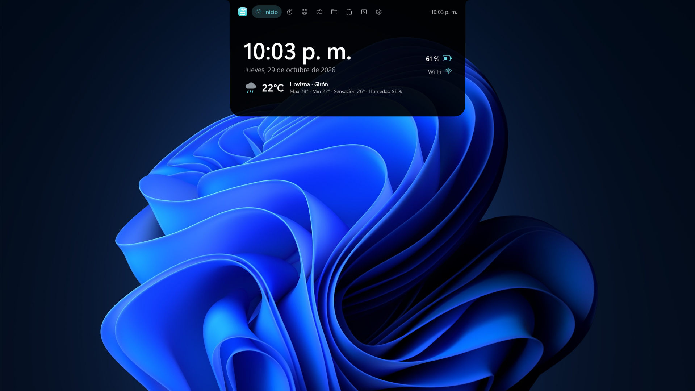
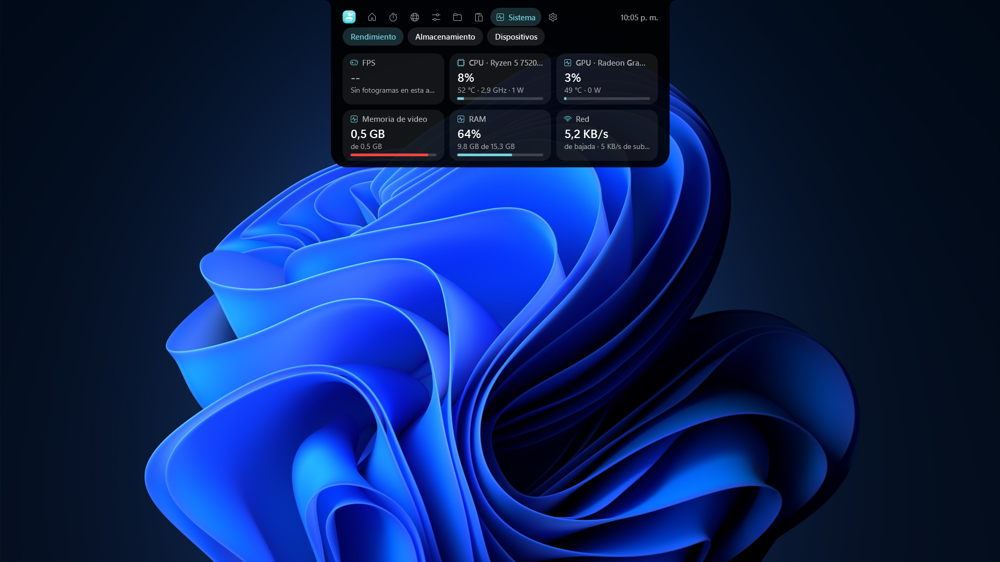
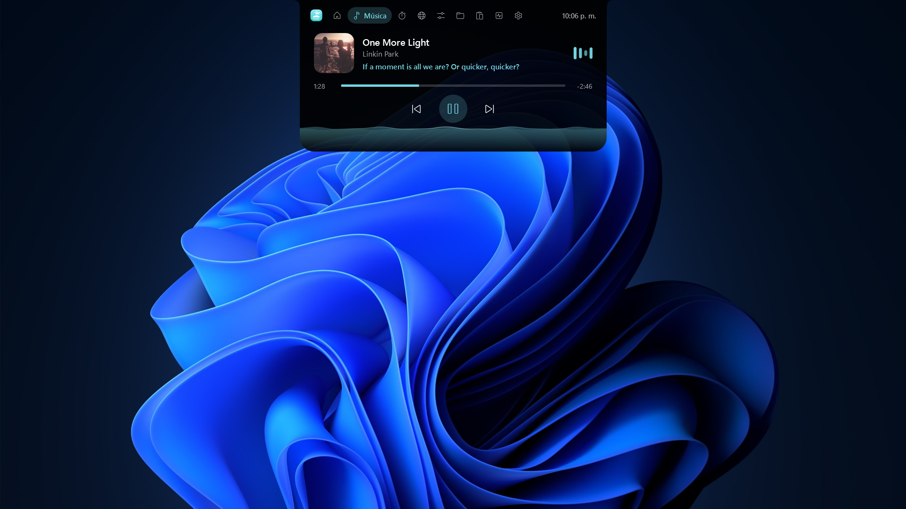
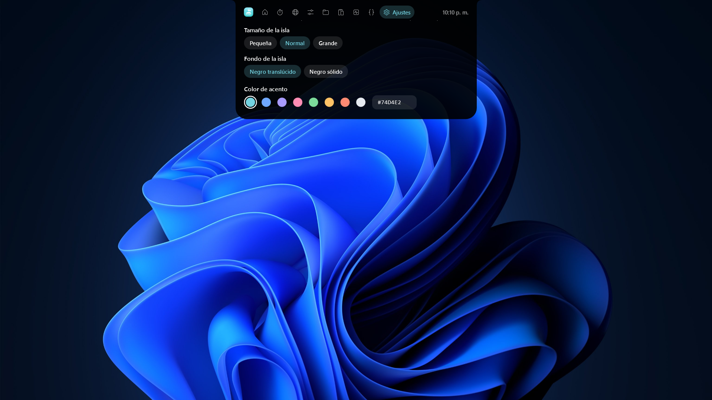
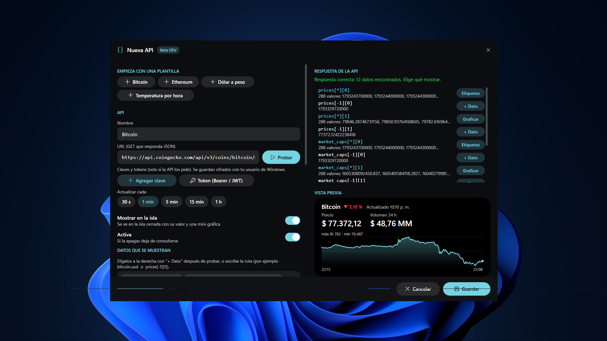

<p align="center">
  
</p>

<h1 align="center">Dynamic Island for Windows</h1>

<p align="center">
  An iPhone-style Dynamic Island for Windows 10 and 11, built for the PC.
</p>

<p align="center">
  
  
  
</p>

> Dynamic Island lives at the top edge of your screen, morphs with spring animations and shows what is happening on your PC: music, calls, performance, timers, translations and more.

## Tech stack

<p align="center">
  
  
  
  
  
  
  <br/>
  
  
  
  
  
  
</p>

## Screenshots

<table>
  <tr>
    <td width="50%" align="center">
      
      <br/><b>Home</b><br/><sub>Time, date, battery, network and today's weather</sub>
    </td>
    <td width="50%" align="center">
      
      <br/><b>System</b><br/><sub>Live performance and hardware statistics</sub>
    </td>
  </tr>
  <tr>
    <td width="50%" align="center">
      
      <br/><b>Music</b><br/><sub>Album art, audio-reactive effects, synced lyrics and controls</sub>
    </td>
    <td width="50%" align="center">
      
      <br/><b>Settings</b><br/><sub>Every module and activity can be turned on or off</sub>
    </td>
  </tr>
  <tr>
    <td colspan="2" align="center">
      
      <br/><b>Custom APIs (Dev Mode)</b><br/><sub>Plug in any JSON API and watch its data live from the island</sub>
    </td>
  </tr>
</table>

> [!NOTE]
> These are only some of the available views. The island also includes timers, a translator, audio and Bluetooth controls, files, clipboard, calls and more.

## Features

| Area | Description |
|---|---|
| **Home** | Time, date, battery, network and today's weather (Open-Meteo) based on the PC's location. |
| **Music** | Album art with dynamic effects that follow the real audio spectrum. Synced lyrics (LRCLIB) on the island and in the panel. Playback controls and progress. |
| **Game mode** | Shown while a game runs in full screen (borderless window). Choose what to see on the island in Settings: FPS, 1% low, frametime, CPU, CPU temperature, GPU, GPU temperature, VRAM, RAM or time (1 to 6 items). Full details when you open it. Music moves to a secondary droplet. |
| **System** | Performance (CPU and GPU model, usage from the same counters as Task Manager, temperatures, FPS and 1% low), storage for each drive like File Explorer, and wireless devices with their battery. |
| **Devices** | Headsets, mice, keyboards and controllers over Bluetooth or a USB receiver, with the battery each device reports. See [Device battery](#device-battery). |
| **Time** | Timer, stopwatch, alarm and focus mode (Pomodoro that turns on Do Not Disturb). |
| **Translator** | Live translation as you type, with text-to-speech (Windows voices). Free Google Translate (MyMemory as fallback) or DeepL with your own key. See [Translator](#translator). |
| **Calls** | Detects when you are on a call or voice chat: Discord, Teams, Zoom, WhatsApp, Telegram, Slack, Signal, TeamSpeak, Steam, Meet in the browser and any other app that uses the microphone while playing audio. When opened: mute the mic, deafen (mutes the call audio) and jump to the app. Toggle it in *Settings > Calls*. |
| **Controls** | Sound (output, microphone and per-app volume), display (brightness on laptops) and Bluetooth. Alerts when the device changes or the mic is muted. |
| **Files** | Drop one or more files on the island. They keep their name and icon (even after a restart), can be dragged or copied to another app, and can be sent to your phone with a QR code over local Wi-Fi. |
| **Clipboard** | Copied text history (memory only) with smart actions: colors, math, links and text in other languages. |
| **Screenshots** | When you copy an image (Win+Shift+S): extract the text (Windows OCR, offline), translate it or save the screenshot. |
| **Bluetooth** | Alert when headsets, mice or keyboards connect, with their battery level. |
| **Alerts** | Volume, brightness, Caps Lock, network, charger, downloads and microphone or camera use. |
| **Custom APIs** | Dev Mode (beta): add your own APIs and show their data live on the island. See [Custom APIs](#custom-apis-dev-mode). |
| **Settings** | Everything above can be turned on or off. |

## Getting started

### Build

1. Run `build.bat`. If the PC does not have the .NET 8 SDK, the script installs it automatically (with winget or, if unavailable, inside the project's `.dotnet` folder, no admin rights needed).
2. The executable is created at `dist\DynamicIsland.exe`. It is self-contained: to use it on another PC, copy the whole `dist` folder (it includes PresentMon and HeadsetControl).

For development, use `run-dev.bat` or open `src\DynamicIsland.csproj` in your IDE.

### Windows warning on another PC

> [!WARNING]
> The executable is not digitally signed, so Windows may block it.
>
> - **SmartScreen** ("Windows protected your PC"): click *More info* and then *Run anyway*. To avoid it, right-click the zip before extracting it, open *Properties* and check *Unblock*. `build.bat` also removes this mark from everything it builds.
> - **Smart App Control** (Windows 11): blocks any unsigned program and has no button to continue. It can be turned off in *Windows Security > App & browser control > Smart App Control settings*. Since the April 2026 update (KB5083769) it can be turned back on later without reinstalling Windows.

## Keyboard shortcuts

| Shortcut | Action |
|---|---|
| `Ctrl + Shift + Space` | Toggle "Hide until hover" |
| `Ctrl + Shift + Y` | Translate the copied text |
| `Ctrl + Shift + F9` | Mute or unmute the microphone |
| `Ctrl + Shift + F10 / F11 / F12` | Previous, play/pause, next |

> [!TIP]
> Shortcuts work inside games, where the mouse is usually captured. `Ctrl + Shift + Space` toggles hidden mode: the island stays invisible until the cursor reaches the center of the top edge, and closes when it leaves. This shortcut can be disabled in *Settings > General > Keyboard shortcuts*.

In *Settings > General* you can turn on "Hide until hover" and choose which activities appear on the minimized island. "Show dynamic activities" is the main switch; below it you can pick music and videos, calls, timers/alarm/focus, system alerts and other activities. Turning off "Music and videos" stops playback monitoring, audio analysis and the module itself. The island keeps running in the background.

The tray icon menu can also hide the island completely and bring it back with "Show island".

## Translator

> Translates **live as you type**, just like the web translator.

- **Live translation:** requests a translation after a 0.25 s pause and, if you keep typing nonstop, refreshes the result about every 0.7 s. If a request is already in flight (slow network), it is allowed to finish instead of being cancelled on every keystroke. Enter, *Translate*, *Paste* and changing the language translate instantly.
- **Free engine:** *Settings > Translator > Google (free)* uses Google Translate's public endpoint (no key needed). If Google does not respond, the island switches to MyMemory automatically. With a DeepL key, DeepL is used.
- **"testvalue" fix:** MyMemory is a crowd-sourced translation memory and, with half-typed words, it sometimes returned junk entries such as `testvalue`. Those answers are now discarded: another valid match is used, or the original text is kept.
- The label next to the languages shows which service answered (Google, MyMemory or DeepL).
- Recent translations are cached in memory (200), so deleting and retyping does not repeat requests.

> [!IMPORTANT]
> Google's endpoint is not an official API. If it is ever limited, the translator keeps working with MyMemory.

## Custom APIs (Dev Mode)

> A customizable API mode: add **any API you want** and see its data **in real time** on the island.

Currently in **beta**. From the APIs page you can:

- **Start from a template** (Bitcoin, Ethereum, Dollar to peso, Hourly temperature) or from scratch.
- **Use any GET URL that returns JSON** and press *Test* to see every value in the response.
- **Pick what to show:** add individual values with *+ Data*, use series as *Labels* or *Chart* them. You can also type the path by hand, for example `bitcoin.usd` or `prices[-1][1]`.
- **Add keys and tokens** (API key or Bearer / JWT) only if the API needs them. They are stored encrypted with your Windows user.
- **Choose the refresh rate:** 30 s, 1 min, 5 min, 15 min or 1 h.
- **Show it on the island:** the closed island shows the value with a mini chart, and the panel shows a live preview with a full chart.

## Settings

Settings are saved in `%LOCALAPPDATA%\DynamicIsland\settings.json` and persist across shutdowns and restarts, including hidden mode and dynamic activity preferences. The same folder contains `log.txt` with errors, useful for reporting problems.

## Performance and FPS

| Data | Source |
|---|---|
| CPU usage | Windows "% Processor Utility" counter, the same one Task Manager uses |
| GPU usage and VRAM | Windows "GPU Engine" and "GPU Adapter Memory" counters, the same ones Task Manager uses |
| Temperatures, power, clocks, fans | LibreHardwareMonitor |
| FPS, frametime and 1% low | Intel PresentMon (any API: DirectX, Vulkan, OpenGL) |

`build.bat` downloads PresentMon automatically next to the executable. If it is missing, a built-in counter is used for DirectX only.

**Permissions**

- **FPS:** require permission to read Windows performance events. Either run as administrator or use *Allow FPS without administrator* in Settings (one time, then sign out).
- **CPU temperature:** requires the PawnIO driver, which `build.bat` installs automatically (Windows asks for permission once), and running the island as administrator. GPU temperatures do not need it.
- If a value is not available it shows `--`; it is never estimated.

### Administrator mode (recommended)

Enabled by default because it unlocks CPU temperature, FPS for any game and dragging files from admin apps. Windows asks for confirmation when the island opens; if "Start with Windows" is enabled in this mode, a scheduled task is created so it does not ask again. It can be changed in Settings or from the tray icon.

> [!NOTE]
> In this mode, files can still be dropped on the island from File Explorer, but Windows does not allow dragging them from the island into non-admin apps: use the *Copy* button and paste with `Ctrl+V`. For FPS without these limitations, use *Allow FPS without administrator*.

## Device battery

Every value comes from the device itself; nothing is estimated from usage time. Accuracy depends on what the manufacturer reports:

| Connection | How it is read | Accuracy |
|---|---|---|
| Bluetooth (headsets, mice, keyboards) | Value the device sends to Windows (hands-free profile or BLE battery service) | Whatever the device reports; many headsets report in 10 % steps |
| Logitech via Unifying, Lightspeed or Bolt receiver, cable or Bluetooth | HID++ 2.0 protocol | Exact percentage on most; some gaming mice only report voltage, shown as approximate (~) |
| Wireless USB headsets (SteelSeries, HyperX, Corsair, Logitech G, Sony INZONE, Audeze and others) | HeadsetControl, which speaks each brand's protocol | Whatever the device reports |
| Xbox controllers (adapter or Bluetooth) | Windows XInput | Only 4 levels: empty, low, medium or high |
| DualSense and DualShock 4 (USB or Bluetooth) | Controller HID report | 10 % steps |

If a device does not report battery it shows as connected with no value. Some brands (for example Razer or Corsair mice over a receiver) use closed protocols that are not supported yet.

## Weather and location

Weather comes from Open-Meteo with this priority:

1. The city chosen in *Settings > Home > Weather city* (type the city and press Search; *Automatic* goes back to normal mode).
2. Windows location, if allowed. Configure it in *Settings > Privacy & security > Location*; there, under *Default location*, you can set the PC's location when it has no GPS or Wi-Fi to calculate it.
3. An approximate location based on the internet connection (it may show another city if your ISP is located elsewhere).

## Privacy and external services

| Feature | Service | What is sent |
|---|---|---|
| Weather | Open-Meteo | Approximate coordinates |
| Location without Windows permission | ipapi.co / ipwho.is | Public IP (any website gets it) |
| City name | BigDataCloud | Coordinates |
| Lyrics | LRCLIB | Song title and artist |
| Translator | Google Translate (MyMemory as fallback) or DeepL | The text to translate |
| Manually chosen weather city | Open-Meteo Geocoding | The city name |
| Custom APIs | The APIs you add | Whatever each API request includes |

> [!NOTE]
> Screenshot OCR, the smart clipboard and language detection work offline. "Send to phone" only works on the local network and the link expires after 15 minutes.

## Known limitations

- Games in exclusive full screen do not allow windows on top; borderless windowed mode works.
- Without PresentMon, FPS is only measured on DirectX 9 to 12.
- Files on the tray shelf are shortcuts to their original location: if they are deleted or moved, they disappear from the list.
- "Do Not Disturb" is toggled through an undocumented internal Windows function; if an update changes it, focus mode keeps working without silencing notifications.
- Battery only appears if the device reports it (see [Device battery](#device-battery)).
- Calls are detected by actual microphone use (Windows audio sessions and the privacy registry). The call disappears a few seconds after the app releases the mic. If an app closes the mic when you mute inside it, the island stops showing the call while you stay muted.
- Calls are ended from the app itself; the island does not hang up.
- Mute acts on the system microphone: it works in any app and nobody hears you, even if the app does not show the mute icon.
- Brightness can only be controlled on built-in laptop displays.
- The island appears on the primary monitor.

## Project structure

```
src/
  App.xaml.cs           Startup, single instance, tray, start with Windows, elevation
  MainWindow.xaml.cs    Priorities, physics, shape and global shortcuts
  Core/                 Springs, geometry, controls, settings and Win32 calls
  Modules/              Island activities (music, game, calls, time, alerts)
  Services/             Audio, spectrum, hardware, translator, clipboard, custom APIs
  Panels/               Expanded panel and its tabs
  Assets/               Logo
docs/                   Logo and screenshots
```

> [!TIP]
> To add a feature, create a class that inherits from `IslandModule` (or `TransientModule` for short alerts) and register it in `MainWindow`.

## Third-party credits

Dynamic Island uses these projects. Thanks to their authors.

**Libraries included in the executable**

| Project | License | Use |
|---|---|---|
| [NAudio](https://github.com/naudio/NAudio) | MIT | Audio, per-app volume and spectrum |
| [LibreHardwareMonitor](https://github.com/LibreHardwareMonitor/LibreHardwareMonitor) | MPL 2.0 | CPU and GPU sensors |
| [TraceEvent (PerfView)](https://github.com/microsoft/perfview) | MIT | Fallback FPS counter |
| [QRCoder](https://github.com/codebude/QRCoder) | MIT | QR codes to send files to your phone |
| [.NET](https://github.com/dotnet/runtime) and [C#/WinRT](https://github.com/microsoft/CsWinRT) | MIT | Platform and Windows APIs |

**External tools** (downloaded or installed separately; their code is not included)

| Project | License | Use |
|---|---|---|
| [Intel PresentMon](https://github.com/GameTechDev/PresentMon) | MIT | FPS for any API |
| [HeadsetControl](https://github.com/Sapd/HeadsetControl) | GPL 3.0 | Wireless USB headset battery |
| [PawnIO](https://github.com/namazso/PawnIO) | GPL 2.0 | Driver to read CPU temperature |

**Online services**

| Service | Use |
|---|---|
| [Open-Meteo](https://open-meteo.com/) | Weather and city search. Data under CC BY 4.0 |
| [LRCLIB](https://lrclib.net/) | Synced lyrics |
| [Google Translate](https://translate.google.com/), [MyMemory](https://mymemory.translated.net/) and [DeepL](https://www.deepl.com/) | Translation |
| [BigDataCloud](https://www.bigdatacloud.com/) | City name from coordinates |
| [ipapi.co](https://ipapi.co/) and [ipwho.is](https://ipwho.is/) | Approximate location when Windows does not provide it |

**Protocol references**

- [Solaar](https://github.com/pwr-Solaar/Solaar): documentation of Logitech's HID++ protocol and battery voltage curve.
- Linux kernel `hid-playstation` driver: DualSense and DualShock 4 battery report format.

Icons use the Segoe Fluent Icons font included with Windows.

## License

Open source under the MIT License. Copyright (c) 2026 Andrey Mantilla Leon. You may use, modify and distribute it freely, keeping the copyright notice and credits. See [LICENSE](LICENSE).
