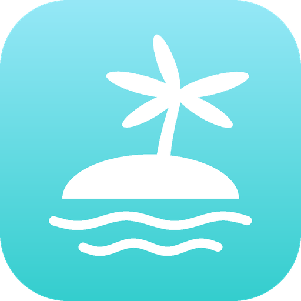

# Dynamic Island para Windows

<p align="center">
  
</p>

Una isla dinámica para Windows 10 y 11, inspirada en la del iPhone pero pensada para PC. Vive pegada al borde superior de la pantalla, se transforma con animaciones de resorte y muestra lo que está pasando en el equipo: música, llamadas, rendimiento, temporizadores y más.

Versión 0.6 · C# · WPF · .NET 8

## Compilar

1. Ejecuta `build.bat`. Si el PC no tiene el SDK de .NET 8, el script lo instala solo (con winget o, si no está disponible, dentro de la carpeta `.dotnet` del proyecto, sin permisos de administrador).
2. El ejecutable queda en `dist\DynamicIsland.exe`. Es autónomo: para usarlo en otro PC copia la carpeta `dist` completa (incluye PresentMon y HeadsetControl).

### Aviso de Windows al abrirla en otro PC

El ejecutable no tiene firma digital, así que Windows puede frenarlo:

- **SmartScreen** ("Windows protegió su PC"): pulsa *Más información* y luego *Ejecutar de todas formas*. Para evitarlo, antes de descomprimir el zip haz clic derecho sobre él, *Propiedades* y marca *Desbloquear*. `build.bat` también quita esta marca a todo lo que compila.
- **Control inteligente de aplicaciones** (Smart App Control, Windows 11): bloquea cualquier programa sin firma y no tiene botón para continuar. Se puede desactivar en *Seguridad de Windows > Control de aplicaciones y del explorador > Configuración de Control inteligente de aplicaciones*. Desde la actualización de abril de 2026 (KB5083769) se puede volver a activar después sin reinstalar Windows.

Para desarrollo, usa `run-dev.bat` o abre `src\DynamicIsland.csproj` en Visual Studio 2022.

## Funciones

| Área | Descripción |
|---|---|
| Inicio | Hora, fecha, batería, red y clima del día (Open-Meteo) según la ubicación del PC. |
| Música | Carátula con efectos dinámicos que siguen el espectro real del audio. Letras sincronizadas (LRCLIB) en la isla y en el panel. Controles y progreso. |
| Modo juego | Solo con la opción de juegos activa y un juego a pantalla completa (modo ventana sin bordes). En Ajustes eliges qué ver en la isla: FPS, 1% low, frametime, CPU, temperatura del CPU, GPU, temperatura de la GPU, VRAM, RAM u hora (de 1 a 6). Los detalles completos están al abrirla. La música queda en una gota secundaria. |
| Sistema | Rendimiento (modelo de CPU y GPU, uso con los contadores del Administrador de tareas, temperaturas, FPS y 1% low), almacenamiento de cada unidad como en el Explorador y dispositivos inalámbricos con su batería. |
| Dispositivos | Audífonos, mouse, teclados y controles conectados por Bluetooth o por receptor USB, con la batería que informa cada dispositivo. Ver la sección Batería de dispositivos. |
| Tiempo | Temporizador, cronómetro, alarma y modo concentración (Pomodoro que activa No molestar). |
| Traductor | Traducción rápida con lectura en voz alta (voces de Windows). MyMemory gratis o DeepL con clave propia. |
| Llamadas | Detecta llamadas en Teams, Zoom, Discord, Meet y otras. Silenciar micrófono, ir a la llamada y colgar (Teams y Zoom). |
| Audio | Volumen por aplicación, salida, micrófono y brillo (portátiles). Avisos al cambiar de dispositivo o silenciar el micrófono. |
| Archivos | Suelta uno o varios archivos en la isla. Se guardan con su nombre e icono (también al reiniciar), se arrastran o copian a otra app y se envían al celular con un código QR por la red Wi-Fi local. |
| Portapapeles | Historial de textos copiados (solo en memoria) e inteligente: colores, operaciones, enlaces y textos en otro idioma. |
| Capturas | Al copiar una imagen (Win+Shift+S): extraer el texto (OCR de Windows, sin internet), traducirlo o guardar la captura. |
| Bluetooth | Aviso al conectar audífonos, mouse o teclados con su nivel de batería. |
| Avisos | Volumen, brillo, Bloq Mayús, red, cargador, descargas y uso de micrófono o cámara. |
| Ajustes | Todo lo anterior se puede activar o desactivar. |

## Atajos de teclado

| Atajo | Acción |
|---|---|
| Ctrl + Shift + Espacio | Abrir o cerrar el panel |
| Ctrl + Shift + Y | Traducir el texto copiado |
| Ctrl + Shift + F9 | Silenciar o activar el micrófono |
| Ctrl + Shift + F10 / F11 / F12 | Anterior, reproducir o pausar, siguiente |

Los atajos funcionan dentro de juegos, donde el mouse suele estar capturado.

## Ajustes

Se guardan en `%LOCALAPPDATA%\DynamicIsland\settings.json` y se conservan al apagar o reiniciar el PC. En la misma carpeta queda `log.txt` con los errores, útil para reportar problemas.

## Rendimiento y FPS

Fuentes de cada dato:

| Dato | Fuente |
|---|---|
| Uso de CPU | Contador "% Processor Utility" de Windows, el mismo del Administrador de tareas |
| Uso de GPU y VRAM | Contadores "GPU Engine" y "GPU Adapter Memory" de Windows, los mismos del Administrador de tareas |
| Temperaturas, potencia, relojes, ventiladores | LibreHardwareMonitor |
| FPS, tiempo por fotograma y 1% low | Intel PresentMon (cualquier API: DirectX, Vulkan, OpenGL) |

`build.bat` descarga PresentMon automáticamente junto al ejecutable. Si no está, se usa un contador propio solo para DirectX.

Permisos:

- **FPS:** requieren permiso para leer eventos de rendimiento de Windows. Hay dos formas: ejecutar como administrador o usar en Ajustes "Permitir FPS sin administrador" (una sola vez, luego cerrar sesión).
- **Temperatura del CPU:** requiere el controlador PawnIO, que `build.bat` instala automáticamente (Windows pide permiso una vez), y ejecutar la isla como administrador. Las temperaturas de la GPU no lo necesitan.
- Si un dato no está disponible se muestra "--"; nunca se estima.

## Batería de dispositivos

Cada valor lo entrega el propio dispositivo; nada se calcula por tiempo de uso. La precisión depende de lo que el fabricante informe:

| Conexión | Cómo se lee | Precisión |
|---|---|---|
| Bluetooth (audífonos, mouse, teclados) | Valor que el dispositivo envía a Windows (perfil manos libres o servicio de batería BLE) | La que dé el dispositivo; muchos audífonos informan en pasos de 10 % |
| Logitech por receptor Unifying, Lightspeed o Bolt, cable o Bluetooth | Protocolo HID++ 2.0 | Porcentaje exacto en la mayoría; algunos mouse gamer solo informan el voltaje y se muestra como aproximado (~) |
| Audífonos inalámbricos USB (SteelSeries, HyperX, Corsair, Logitech G, Sony INZONE, Audeze y otros) | HeadsetControl, que habla el protocolo de cada marca | La que dé el dispositivo |
| Controles Xbox (adaptador o Bluetooth) | XInput de Windows | Solo 4 niveles: vacía, baja, media o alta |
| DualSense y DualShock 4 (USB o Bluetooth) | Reporte HID del control | Pasos de 10 % |

Si un dispositivo no informa batería aparece como conectado sin dato. Algunas marcas (por ejemplo los mouse Razer o Corsair por receptor) usan protocolos cerrados que todavía no están soportados.

## Clima y ubicación

El clima se toma de Open-Meteo con esta prioridad:

1. La ciudad elegida en *Ajustes > Inicio > Ciudad del clima* (escribe la ciudad y pulsa Buscar; *Automática* vuelve al modo normal).
2. La ubicación de Windows, si está permitida. Se configura en *Configuración > Privacidad y seguridad > Ubicación*; ahí mismo, en *Ubicación predeterminada*, se puede fijar la ubicación del PC cuando no tiene GPS ni Wi-Fi para calcularla.
3. Una ubicación aproximada según la conexión a internet (puede marcar otra ciudad si el proveedor de internet está en otra parte).

## Modo administrador (recomendado)

Viene activado por defecto porque habilita la temperatura del CPU, los FPS de cualquier juego y el arrastre de archivos desde apps de administrador. Windows pide confirmación al abrir la isla; si se activa "Iniciar con Windows" en este modo, se crea una tarea programada para que no vuelva a preguntar. Se puede cambiar en Ajustes o desde el icono de la bandeja. En este modo los archivos se pueden seguir soltando en la isla desde el Explorador, pero Windows no permite arrastrarlos desde la isla hacia apps sin permisos: usa el botón Copiar y pega con Ctrl+V. Para FPS sin estas limitaciones, usa "Permitir FPS sin administrador".

## Privacidad y servicios externos

| Función | Servicio | Qué se envía |
|---|---|---|
| Clima | Open-Meteo | Coordenadas aproximadas |
| Ubicación sin permiso de Windows | ipapi.co / ipwho.is | La IP pública (lo hace cualquier sitio web) |
| Nombre de la ciudad | BigDataCloud | Coordenadas |
| Letras | LRCLIB | Título y artista de la canción |
| Traductor | MyMemory o DeepL | El texto a traducir |
| Ciudad del clima elegida a mano | Open-Meteo Geocoding | El nombre de la ciudad |

El OCR de capturas, el portapapeles inteligente y la detección de idioma funcionan sin internet. "Enviar al celular" solo funciona dentro de la red local y el enlace caduca a los 15 minutos.

## Limitaciones conocidas

- Los juegos en pantalla completa exclusiva no permiten ventanas encima; en modo ventana sin bordes sí funciona.
- Sin PresentMon, los FPS solo se miden en DirectX 9 a 12.
- Los archivos de la bandeja son accesos a su ubicación original: si se borran o mueven, desaparecen de la lista.
- "No molestar" se activa con una función interna de Windows sin documentación oficial; si una actualización la cambia, el modo concentración sigue funcionando sin silenciar notificaciones.
- La batería solo aparece si el dispositivo la informa (ver Batería de dispositivos).
- Colgar desde la isla usa el atajo de cada app y solo está disponible en Teams y Zoom. Silenciar actúa sobre el micrófono del sistema, por lo que funciona en cualquier app, aunque la app no lo muestre.
- El brillo solo se controla en pantallas integradas de portátiles.
- La isla aparece en el monitor principal.

## Estructura

```
src/
  App.xaml.cs           Inicio, instancia única, bandeja, inicio con Windows, elevación
  MainWindow.xaml.cs    Prioridades, física, forma y atajos globales
  Core/                 Resortes, geometría, controles, ajustes y llamadas Win32
  Modules/              Actividades de la isla (música, juego, llamadas, tiempo, avisos)
  Services/             Audio, espectro, hardware, traductor, portapapeles
  Panels/               Panel expandido y sus pestañas
  Assets/               Logo
```

Para agregar una función, crea una clase que herede de `IslandModule` (o `TransientModule` para avisos cortos) y regístrala en `MainWindow`.

## Créditos de terceros

Dynamic Island usa estos proyectos. Gracias a sus autores.

Bibliotecas incluidas en el ejecutable:

| Proyecto | Licencia | Uso |
|---|---|---|
| [NAudio](https://github.com/naudio/NAudio) | MIT | Audio, volumen por app y espectro |
| [LibreHardwareMonitor](https://github.com/LibreHardwareMonitor/LibreHardwareMonitor) | MPL 2.0 | Sensores de CPU y GPU |
| [TraceEvent (PerfView)](https://github.com/microsoft/perfview) | MIT | Conteo de FPS de respaldo |
| [QRCoder](https://github.com/codebude/QRCoder) | MIT | Códigos QR para enviar al celular |
| [.NET](https://github.com/dotnet/runtime) y [C#/WinRT](https://github.com/microsoft/CsWinRT) | MIT | Plataforma y APIs de Windows |

Herramientas externas (se descargan o instalan aparte; no se incluye su código):

| Proyecto | Licencia | Uso |
|---|---|---|
| [Intel PresentMon](https://github.com/GameTechDev/PresentMon) | MIT | FPS de cualquier API |
| [HeadsetControl](https://github.com/Sapd/HeadsetControl) | GPL 3.0 | Batería de audífonos inalámbricos USB |
| [PawnIO](https://github.com/namazso/PawnIO) | GPL 2.0 | Controlador para leer la temperatura del CPU |

Servicios en línea:

| Servicio | Uso |
|---|---|
| [Open-Meteo](https://open-meteo.com/) | Clima y búsqueda de ciudades. Datos bajo licencia CC BY 4.0 |
| [LRCLIB](https://lrclib.net/) | Letras sincronizadas |
| [MyMemory](https://mymemory.translated.net/) y [DeepL](https://www.deepl.com/) | Traducción |
| [BigDataCloud](https://www.bigdatacloud.com/) | Nombre de la ciudad a partir de coordenadas |
| [ipapi.co](https://ipapi.co/) y [ipwho.is](https://ipwho.is/) | Ubicación aproximada cuando Windows no la da |

Referencias de protocolos:

- [Solaar](https://github.com/pwr-Solaar/Solaar): documentación del protocolo HID++ de Logitech y curva de voltaje de batería.
- Controlador `hid-playstation` del kernel de Linux: formato del reporte de batería de DualSense y DualShock 4.

Los iconos son la fuente Segoe Fluent Icons incluida en Windows.

## Licencia

Código abierto bajo licencia MIT. Copyright (c) 2026 Andrey Mantilla Leon. Puedes usarlo, modificarlo y distribuirlo libremente, manteniendo el aviso de copyright y los créditos. Ver [LICENSE](LICENSE).
